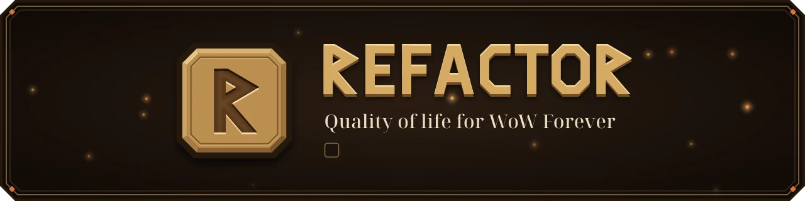
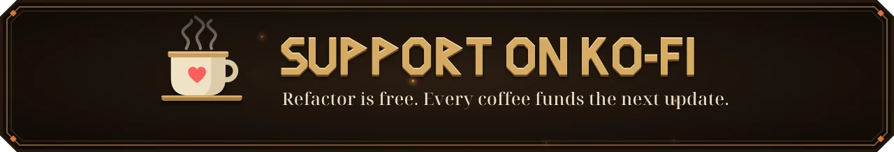

<p align="center">
  
</p>

<p align="center">
  
  
  
</p>

<p align="center">
  <b>Small features, each explained in a line, each switchable per character.</b><br>
  <a href="#install">Install</a> &middot;
  <a href="#features">Features</a> &middot;
  <a href="#slash-commands">Commands</a> &middot;
  <a href="#support">Support</a>
</p>

---

Refactor removes the clicks you never wanted and leaves everything else alone. It never touches
secure frames, never reskins Blizzard's UI, and no automation runs unless you turned it on yourself.

Made for WoW Forever, and the same files run on Retail 12.1. Every game call is checked against
both clients' own API before a release.

## Why Refactor

- **One list.** Every feature is a row with a checkbox and a line saying what it does. Search
  finds any feature or setting by name, description or option.
- **Your call, per character.** Switches are account wide, a profile can cover a group of
  characters, and any character can override any feature.
- **Nothing acts for you by default.** Features that accept, decline or invite start off. Hold
  the pause modifier, Ctrl by default, at the moment of any automatic action to skip it.
- **No taint.** No secure templates, no protected calls, no changes to secure frames in combat.
- **Light.** Load time, memory and CPU have budgets that gate every release, down to zero
  `OnUpdate` handlers while idle. See [Performance budgets](#performance-budgets).
- **Plays nicely.** Where another addon owns a job, Refactor steps aside and says so.

## Contents

- [Install](#install)
- [Getting started](#getting-started)
- [Features](#features)
  - [Quest](#quest)
  - [Loot](#loot)
  - [Vendor](#vendor)
  - [Items](#items)
  - [Interface and camera](#interface-and-camera)
  - [Chat](#chat)
  - [Social](#social)
  - [Tooltips](#tooltips)
- [Defaults](#defaults)
- [Account, profiles and per-character settings](#account-profiles-and-per-character-settings)
- [Price sources](#price-sources)
- [Plays nicely with](#plays-nicely-with)
- [Slash commands](#slash-commands)
- [Performance budgets](#performance-budgets)
- [Development](#development)
- [Support](#support)
- [License](#license)

---

## Install

1. Download the release zip.
2. Extract it into `Interface/AddOns/` so the folder is `AddOns/Refactor`.
3. If the build predates the current patch, tick **Load out of date AddOns** on the character
   selection screen.

## Getting started

Refactor starts with a sensible set of features on, see [Defaults](#defaults). Switches are account
wide, so a new character inherits them without a click.

Open the window any of these ways:

| How | What |
|---|---|
| Minimap button | Left click opens. Right click opens Diagnostics. Drag moves it. |
| `/refactor` or `/rf` | Opens the window. `/rf` steps aside if another addon claimed it. |
| `/refactor junk` | Opens the window searching for any words you give it. |
| Broker display | A Refactor launcher appears in Titan Panel, ChocolateBar or ElvUI when one is loaded. |
| Blizzard Settings | A Refactor category with an Open button. |

Every feature is one row: a checkbox, its name, a line saying what it does, and a chevron when
it has settings of its own. Hover a row for the full explanation. Search covers names,
descriptions, explanations and every setting, so you never need to know which feature owns an
option.

Hold the **pause modifier** (Ctrl by default) at the moment of any automatic action to skip it.

---

## Features

The **Default** column says whether a feature is on before you touch it.

### Quest

| Feature | What it does | Default |
|---|---|---|
| **Auto accept quests** | Accepts a quest as soon as its dialog opens, and works through every quest an NPC offers. Skips PvP and repeatable quests. | Off |
| **Auto turn in quests** | Completes a quest when there is nothing to choose. A reward choice, or a quest that costs gold, stays yours. | Off |
| **Auto gossip** | Picks the gossip option you would have picked: an NPC's only quest, a finished hand-in, the one shop or trainer option among small talk. Shift click any option to teach it a choice for that NPC. Never picks payments, spells or rewards. | Off |
| **Quest progress on nameplates** | How many more of a mob you need, on its nameplate, with an icon for kill and item objectives. Choose the side, dim finished mobs, reduce animation. | On |

### Loot

| Feature | What it does | Default |
|---|---|---|
| **Fast loot** | Loots everything at once as soon as the window opens, when auto-loot is on. | On |
| **Loot feed** | A rolling feed of what you loot: icon, name, count and price. A loot of several items collapses into one row you can open. Hover a row to keep it; right click dismisses it. Move and size it in Edit Mode. | Off |
| **Farm session HUD** | What this farming session earns per hour: gold, items, your best drop and a goal meter. Starts on the first loot, pauses when you idle, and hands you a summary you can copy. | Off |

### Vendor

| Feature | What it does | Default |
|---|---|---|
| **Sell junk** | Sells every grey stack when a merchant window opens. Drag an item onto the never-sell slot to keep it forever. | On |
| **Auto repair** | Repairs with your own gold, under a cap you set. Never touches guild funds. | On |
| **Vendor summary** | One chat line with what was actually sold and repaired when you leave. | On |
| **Bigger merchant window** | More rows and columns in Blizzard's own merchant window, from two by five up to five by eight. Paging and the wheel follow. | On |
| **Clearer merchant costs** | Greys out only the currency you are short of, and lists what the merchant takes in the coin box, including item costs. | On |
| **Merchant filter** | A dropdown to show only mounts, pets, toys, appearances or recipes, owned or missing, laid out on pages of their own. | On |

### Items

| Feature | What it does | Default |
|---|---|---|
| **Fill DELETE confirmation** | Types DELETE into the item deletion box for you. You still click Yes. | Off |

### Interface and camera

| Feature | What it does | Default |
|---|---|---|
| **Maximum camera distance** | Lets the camera zoom out further than the options menu allows, on a slider. | Off |
| **ActionCam** | Camera profiles: Blizzard's Basic, On and Full, plus Refactor's **Immersive**, **Controller: Ranged**, **Controller: Melee**, **Cinematic**, **Raider**, **Melee** and **Comfort**. Each names a camera distance and shoulder offset for where you are: indoors, in a city or inn, on a mount, in combat, talking to an NPC, or in a dungeon, raid, battleground or arena. Press Customize to make any profile your own, and share it as a string. | Off |
| **Screenshot on level up** | Takes a screenshot a moment after you level, so the effect is in frame. | Off |
| **Place new abilities** | Puts an ability you just learned on the first free slot of an action bar you can see. | Off |
| **Zone levels on the map** | A zone's level range beside its name when you hover it on the world map, coloured by difficulty. | On |
| **Reveal the map** | Draws the parts of each map you have not explored yet, dimmed. | Off |
| **UI visibility** | Fades bars, frames, chat and the minimap out until you mouse over them or need them. Presets, then per-element rules in Edit Mode. Alpha only, so every keybind still works. | Off |

### Chat

| Feature | What it does | Default |
|---|---|---|
| **Clickable links in chat** | Web addresses become links that open a copy box. | On |
| **Copy chat** | A Copy button on each chat window that hands you its text as plain lines. | On |

### Social

| Feature | What it does | Default |
|---|---|---|
| **Auto decline duels** | Declines every duel request without a popup. | Off |
| **Auto accept resurrection** | Accepts a player's resurrection out of combat. Choose where: battlegrounds, dungeons and raids, the open world. | Off |
| **Auto accept party invites** | Joins a group when a friend, Battle.net friend or guild member invites you. Anyone else still gets the popup. | Off |
| **Quick invite** | Hold a key, Alt unless you change it, and click a player to invite them with no menu. | Off |
| **Update notice** | One chat line when someone in your guild or group runs a newer Refactor. | On |

### Tooltips

| Feature | What it does | Default |
|---|---|---|
| **Coloured tooltip border** | Tints the tooltip border with the item's quality colour, or a player's class colour. | On |
| **Tooltip anchor** | Moves the default tooltip to the cursor or a fixed screen point, with offsets. | Off |
| **Hide the tooltip health bar** | Removes the green health bar under a unit tooltip. | Off |

---

## Defaults

There is no setup screen. Features that only add information or save a click start on: fast
loot, sell junk, auto repair, the vendor summary, the merchant window changes, clickable chat
links and copy chat, the tooltip border, zone levels on the map, quest progress on nameplates
and the update notice. Anything that acts on your behalf, such as accepting quests or invites,
or that changes the camera or how the screen looks, starts off. Every feature has its own
toggle.

## Account, profiles and per-character settings

The switch at the top of the feature list says which layer your clicks change:

- **Account defaults** apply to every character that has no profile.
- A **profile** is a named set of feature switches. Pick one for a character under Profiles and
  the switch points at it, so your clicks change the profile and every character using it.
  Export a profile as a string, import a friend's.
- **This character** overrides any feature for the current character only. A feature set this
  way says so on its row while you look at another layer.

Options such as the repair cap, the never-sell list and camera profiles are account wide.

## Price sources

Vendor sell price is always on. **TradeSkillMaster** (with a custom price string) and
**Auctionator** are opt-in under General. A price from an auction database is labelled with its
source wherever it is shown: the loot feed, the farm HUD and the merchant window.

## Plays nicely with

Refactor steps aside where another addon owns the job, and the Conflicts page names every
installed addon that overlaps a Refactor feature, with a button to switch Refactor's version off.

| Addon | What happens |
|---|---|
| Questie, Plater, Threat Plates, NeatPlates | Quest progress on nameplates stands down. |
| Plumber | Clearer merchant costs stands down while its Merchant Price is on. |
| ElvUI, Bartender4, Dominos | UI visibility leaves the bars and frames they draw alone. |
| Leatrix Plus, Scrap, Dejunk, Peddler, AutoTurnIn, DynamicCam, Leatrix Maps, Mapster, TipTac, BasicChatMods, Prat, XLoot Monitor | Listed under Conflicts against the features they share. |

## Slash commands

| Command | What it does |
|---|---|
| `/refactor` | Open or close the window. |
| `/refactor <words>` | Open the window searching for those words. |
| `/refactor changelog` | Open the window on What's new. |
| `/refactor errors` | Print anything Refactor's error boundaries caught, with a trace. |
| `/refactor errors clear` | Forget the recorded errors. |
| `/refactor saved` | Say whether the client handed the saved settings back at login. |
| `/refactor update` | Which Refactor version your guild and group run. |
| `/refactor bench` | Load time, memory, garbage rate and CPU per frame, for release gates. |
| `/refactor loottest` | Push sample rows through the loot feed and name any texture that failed to load. |
| `/refactor farmtest` | Fill the farm HUD with a sample session. |
| `/refactor invitetest` | Say what quick invite saw on your last modified click. |
| `/refactor spelltest` | Say why a new ability did not go on a bar, and try again. |
| `/refactor help` | List these commands. |

## Performance budgets

These are release gates, measured by `/refactor bench`.

| Metric | Budget |
|---|---|
| Load time, all modules | under 30 ms |
| CPU idle, capital city | under 0.10 ms per frame |
| CPU, 25-player combat | under 0.30 ms per frame |
| Memory after load | under 1.5 MB |
| Memory growth per hour | under 100 KB |
| Active `OnUpdate` handlers while idle | 0 |

---

## Development

```
make check     # luacheck, project rules, busted specs, API symbol check
make package   # deterministic zip in .release/
make api-index # regenerate Data/api-retail.json from a wow-ui-source checkout
```

`make dev-setup` installs busted, luacheck and dkjson into a local `.tools` tree.

`python3 Tools/Preview/run.py --shots` loads the real addon into a mock with working anchors
and draws every window, settings block, panel, the loot feed and the farm HUD as HTML and PNG
in `.preview/`, for judging a layout without starting the game. Blizzard's own art is drawn as
stand-ins, so it shows placement and spacing, not the final look.

`python3 Tools/Branding/build.py` draws the icon, the in-game icon TGAs and both banners on this
page from one set of shapes. It needs `rsvg-convert` and Pillow.

Every API symbol a module uses is declared in its `requires` list and verified against
`Data/api-retail.json`, which is generated from Blizzard's own interface source for the
installed build. A symbol that cannot be found there does not ship.

The working contract is in `CLAUDE.md`, the product spec in `docs/refactor-prd.md`, and the
delivery order in `docs/ROADMAP.md`.

## Support

Refactor is free. If it saves you some clicks, a coffee helps fund the next update.

<a href="https://ko-fi.com/profetgit"></a>

## License

All rights reserved.
